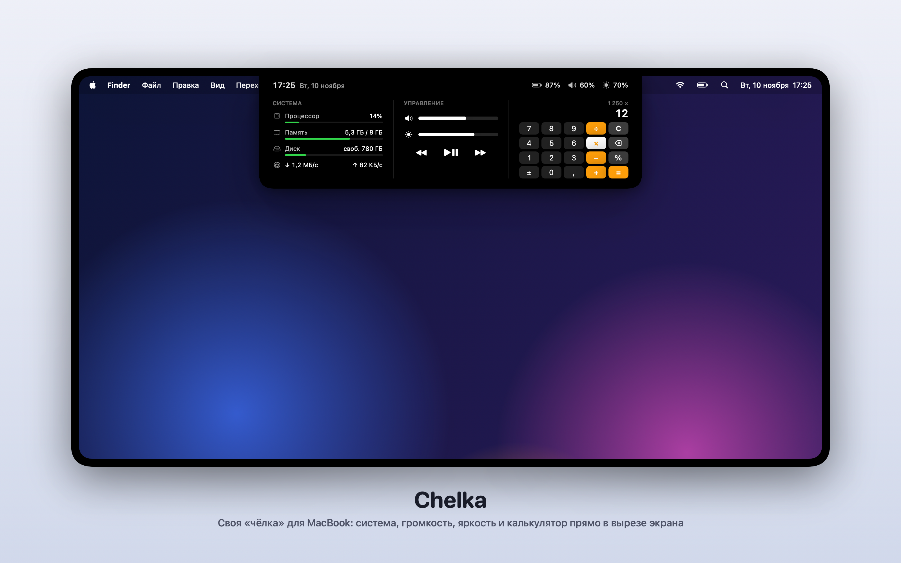

# Chelka



Своя панель в вырезе экрана MacBook, по мотивам Boring Notch. Наводишь мышь на вырез у камеры, и он раскрывается вниз.

**Верхняя строка**, по бокам от камеры:
- слева: время и дата;
- справа: заряд батареи, громкость, яркость.

**Три колонки**:
- **Система**: загрузка процессора, занятая память (цвет полоски показывает, сколько памяти реально свободно по оценке macOS), свободное место на диске, скорость сети ↓ ↑.
- **Управление**: ползунки громкости и яркости (клик по динамику выключает звук), кнопки ⏮ ⏯ ⏭ для музыки, в том числе в браузере.
- **Калькулятор**: четыре действия, проценты (50 + 10% = 55), смена знака, стирание последней цифры. Над числом мелко видно первое число и действие, выбранное действие подсвечено. Клик по числу копирует его в буфер обмена. Считает точно: 0,1 + 0,2 = 0,3. Действия выполняются по очереди, как в калькуляторе macOS: 2 + 3 × 4 = 20.

Убираешь мышь, и панель сворачивается обратно в вырез. Правый клик по раскрытой панели открывает меню «Запускать при входе» и «Выйти».

При первом запуске Chelka сама включает автозапуск, чтобы не пропадать после перезагрузки. Если выключить его в меню, Chelka больше не будет его включать.

## Сборка
```bash
./build.sh            # собрать в build/Chelka.app
./build.sh install    # собрать и положить в ~/Applications
./build.sh snapshot   # нарисовать панель с примерными данными: build/snapshot.png и snapshot-calc.png
build/Chelka.app/Contents/MacOS/Chelka --probe   # вывести настоящие показания датчиков
build/Chelka.app/Contents/MacOS/Chelka --promo docs/chelka.png   # картинка для README и друзей
```
Нужны Command Line Tools (`swiftc`), macOS 14 или новее. Подпись ad-hoc.

## Разрешения
- **Универсальный доступ** нужен только кнопкам ⏮ ⏯ ⏭: они отправляют системе нажатие медиаклавиши, как F7–F9. macOS спросит доступ при первом нажатии. После пересборки доступ сбрасывается, и его нужно выдать заново.
- Всё остальное работает без разрешений.

## Как устроено
| Файл | Что внутри |
|---|---|
| `Sources/main.swift` | запуск, автозапуск, режимы `--snapshot` и `--probe` |
| `Sources/NotchController.swift` | окно над строкой меню, размер выреза, раскрытие при наведении |
| `Sources/Views.swift` | вид панели (SwiftUI), форматирование чисел |
| `Sources/Providers.swift` | процессор, память, диск, сеть, батарея, громкость (CoreAudio), яркость, медиаклавиши |
| `Sources/Calculator.swift` | калькулятор (логика, без интерфейса) |
| `Sources/Snapshot.swift` | картинки панели для проверки вёрстки |

## Решения и ограничения
- Показания обновляются раз в секунду и **только пока панель раскрыта**.
- В свёрнутом виде программа ничего не опрашивает: о движении мыши ей сообщает macOS (для событий мыши разрешения не нужны). В покое Chelka занимает 0% процессора и около 18 МБ памяти. Пока панель раскрыта, мышь проверяется 20 раз в секунду, чтобы вовремя свернуться.
- Название трека из браузера не показываем: системный «Сейчас играет» с macOS 15.4 закрыт для сторонних программ. Кнопки ⏮ ⏯ ⏭ работают как медиаклавиши: их получает тот, кто играл звук последним.
- Скорость сети считается только по физическим интерфейсам (Wi-Fi, кабель). VPN не учитывается отдельно, чтобы трафик не удваивался.
- Яркость меняется через системную библиотеку DisplayServices: открытого способа у Apple нет. Работает только для встроенного экрана.
- Музыку (Apple Music и Spotify) и календарь убрали в версии 0.2: пользователь слушает музыку в браузере и не ведёт календарь.
- Таймер заменили калькулятором в версии 0.3.
- Калькулятор работает только мышью: чтобы принимать цифры с клавиатуры, панели пришлось бы забирать фокус у программы, в которой ты печатаешь.
- Идеи на потом: полка для файлов, «не засыпать», переключение тёмной темы, погода.
