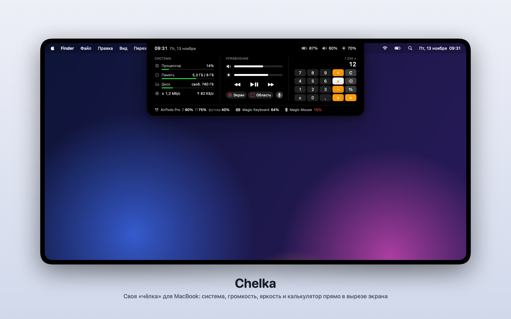

# macUtilities

Маленькие самописные утилиты для macOS. Каждая лежит в своей папке, собирается одной командой и ничего не тянет из интернета.

| Утилита | Что делает |
|---|---|
| [Chelka](Chelka/) | Панель в вырезе экрана MacBook: время, заряд, громкость, яркость, монитор системы, кнопки ⏯ для музыки в браузере, калькулятор, запись экрана, заряд Bluetooth-устройств |
| [DockToggle](DockToggle/) | Повторный клик по иконке активного приложения в Доке прячет его, как в Windows |



## Как поставить
Подойдёт любой Mac: на Apple Silicon (M1 и новее) и на Intel. Открой Терминал (⌘ Пробел → «Терминал») и вставь одну строку:
```bash
curl -fsSL https://raw.githubusercontent.com/l1tooo/macUtilities/main/install.sh | zsh
```
Скрипт сам поставит инструменты разработчика Apple, если их нет (откроется окно, нажми «Установить»), скачает исходники в `~/macUtilities`, соберёт Chelka у тебя на Маке, положит в `~/Applications` и запустит.

Другие утилиты:
```bash
curl -fsSL https://raw.githubusercontent.com/l1tooo/macUtilities/main/install.sh | zsh -s -- DockToggle
```
```bash
curl -fsSL https://raw.githubusercontent.com/l1tooo/macUtilities/main/install.sh | zsh -s -- all
```

Скрипт можно прочитать перед запуском: [install.sh](install.sh).

Почему сборка у себя, а не готовый `.app`: программы не подписаны сертификатом Apple, и скачанный файл macOS заблокирует. Собранное у себя запускается без вопросов, а код можно прочитать: в каждой утилите всего несколько файлов.

<details>
<summary>Вручную, без скрипта</summary>

```bash
xcode-select --install
git clone https://github.com/l1tooo/macUtilities.git ~/macUtilities
cd ~/macUtilities/Chelka        # или DockToggle
./build.sh install              # соберёт и положит в ~/Applications
open ~/Applications/Chelka.app
```
</details>

Подробности, разрешения и ограничения описаны в README каждой утилиты.

## Обновить
Запусти ту же команду установки ещё раз: она подтянет свежие исходники и пересоберёт программу.
После пересборки macOS может заново спросить разрешения (например, «Универсальный доступ»). Если утилита в списке уже есть, но не работает, удали её там кнопкой «−» и добавь снова.
